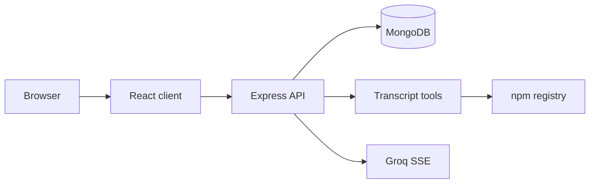

# Orchion

A real-time chat workspace for a task-executing AI agent — built for developers who want to watch the work, not just the answer.

  

## Visual Preview

Add screenshots or a short GIF under `docs/` when a deployable environment is available.

## System Architecture



See the [interactive architecture map](docs/architecture.html). The client sees a single SSE transport while the API keeps model credentials and persistence controls server-side.

> **Phase 4 — full-stack.** Orchion is now a React client plus an Express API. The Groq key lives only on the server, slash commands execute real tools that inspect the stored transcript (and the npm registry), and every thread is saved to MongoDB against an authenticated user.

---

## Stack

| Concern     | Choice                                                     |
| ----------- | ---------------------------------------------------------- |
| Frontend    | React 19 + Vite 8 + TypeScript                             |
| Styling     | Tailwind CSS v4 (`@tailwindcss/vite`)                      |
| API         | Node.js + Express 5                                        |
| Database    | MongoDB via Mongoose 8 (`User`, `Session`, `Message`)      |
| Model calls | Groq Chat Completions, streamed as SSE through the proxy   |
| Auth        | Bearer tokens signed with HMAC-SHA256; scrypt passwords    |
| Linting     | Oxlint                                                     |

---

## Quick start

**Prerequisites:** Node.js 20+ and a MongoDB server. MongoDB is already running as a Windows service on this machine (`Get-Service MongoDB`). Alternatives:

```bash
# Docker
docker run -d --name orchion-mongo -p 27017:27017 mongo:7

# …or point MONGODB_URI at an Atlas cluster
```

```bash
npm install
cp server/.env.example server/.env     # PowerShell: Copy-Item server/.env.example server/.env
# edit server/.env → GROQ_API_KEY=… and AUTH_SECRET=…
npm run dev                            # API + Vite together
```

`npm run dev` starts both processes with `concurrently`:

| Process | URL                      | Command            |
| ------- | ------------------------ | ------------------ |
| API     | http://localhost:8787    | `npm run dev:server` (`node --watch`) |
| Web     | http://localhost:5173    | `npm run dev:client` (`vite`)         |

Run them separately in two terminals if you prefer. Vite proxies `/api/*` to the API, so the browser only ever talks to its own origin.

### Environment (`server/.env`)

| Variable        | Required | Purpose                                                       |
| --------------- | -------- | ------------------------------------------------------------- |
| `GROQ_API_KEY`  | for chat | Groq key ([console.groq.com/keys](https://console.groq.com/keys)). Tools still run without it. |
| `MONGODB_URI`   | yes      | Defaults to `mongodb://127.0.0.1:27017/orchion`                |
| `AUTH_SECRET`   | strongly | HMAC key for tokens. If omitted, an ephemeral key is generated and every session dies on restart. |
| `PORT`          | no       | API port, default `8787`                                       |
| `GROQ_MODEL`    | no       | Default `openai/gpt-oss-120b`                                  |

Generate a secret:

```bash
node -e "console.log(require('node:crypto').randomBytes(32).toString('hex'))"
```

The key is **never** prefixed with `VITE_`, never imported by the client, and never logged. `server/.env` is git-ignored; only `server/.env.example` is tracked.

---

## Architecture

```
Orchion/
├── server/
│   ├── index.js              Express app, Mongo startup, JSON error handler
│   ├── config.js             dotenv loading + parsed env
│   ├── db.js                 Mongoose connect / disconnect
│   ├── models/
│   │   ├── User.js           guest | account, activeSessionId
│   │   ├── Session.js        thread + embedded artifacts
│   │   └── Message.js        turns with optional tool payload
│   ├── auth/
│   │   ├── tokens.js         HMAC-SHA256 signed bearer tokens
│   │   ├── passwords.js      scrypt hashing (Node built-ins)
│   │   └── middleware.js     requireAuth → req.userId
│   ├── routes/
│   │   ├── auth.js           guest, register, login, me
│   │   ├── sessions.js       thread + message CRUD
│   │   └── chat.js           SSE proxy + tool orchestration
│   ├── lib/
│   │   ├── groq.js           prompt building, upstream SSE parsing, error copy
│   │   └── validate.js       payload limits and shape checks
│   └── tools/
│       ├── transcript.js     term/sentence/code-block analysis
│       └── index.js          real tool runners
├── src/
│   ├── App.tsx               hydration, debounced snapshot sync, boot screen
│   ├── services/
│   │   ├── api.ts            guest bootstrap + authorized fetch
│   │   ├── chatTransport.ts  `/api/chat` SSE parser, same event contract
│   │   └── sessionStorage.ts sessions API client (no localStorage data)
│   └── components/           Sidebar, ChatHeader, MessageList, AgentDrawer…
├── vite.config.ts            `/api` proxy for dev and preview
└── server/.env.example
```

The UI never imports a key or a model endpoint; it knows one transport function and four stream events.

---

## API

| Method | Path                                       | Purpose                              |
| ------ | ------------------------------------------ | ------------------------------------ |
| GET    | `/api/health`                              | Mongo + Groq status                  |
| POST   | `/api/auth/guest`                          | Create an isolated guest account     |
| POST   | `/api/auth/register`                       | Email + password account             |
| POST   | `/api/auth/login`                          | Issue a token                        |
| GET    | `/api/auth/me`                             | Current user + active thread         |
| PATCH  | `/api/auth/me`                             | Remember the active thread           |
| GET    | `/api/sessions`                            | Threads + messages + active id       |
| POST   | `/api/sessions`                            | Create (idempotent by `id`)          |
| GET    | `/api/sessions/:id`                        | One thread with its messages         |
| PATCH  | `/api/sessions/:id`                        | Rename                               |
| PUT    | `/api/sessions/:id`                        | Full snapshot sync (upsert messages) |
| DELETE | `/api/sessions/:id`                        | Delete a thread and its messages     |
| DELETE | `/api/sessions`                            | Delete every thread (reset helper)   |
| POST   | `/api/sessions/:id/messages`               | Append a message                     |
| DELETE | `/api/sessions/:id/messages/:messageId`    | Delete a message                     |
| POST   | `/api/chat`                                | SSE: tool events + Groq tokens       |

Every route except `/api/health`, `/api/auth/guest`, `/api/auth/register` and `/api/auth/login` requires `Authorization: Bearer <token>`.

### Auth model

- The client calls `/api/auth/me` with any stored token; a 401 triggers one fresh `POST /api/auth/guest`. That keeps the demo usable with no login screen while still giving every browser its own user id.
- `register` / `login` exist for the account flow and are verified by the API smoke test; a dedicated sign-in UI is still Phase 5.
- Tokens are `base64url(payload).hmacSHA256` with `sub`, `iat` and a 30-day `exp`. The server never trusts a client-supplied user id — it derives it from the signed token and scopes every query by it.
- Passwords use `scrypt` with a per-user salt; comparison is constant-time.

### Data model

```
User     { name, email?, passwordHash?, kind: guest|account, activeSessionId }
Session  { userId, sessionId, title, model, displayUpdatedAt, artifacts[] }
Message  { userId, sessionId, messageId, role, content, status, tool?, order }
```

Indexes: unique `(userId, sessionId)` for threads, unique `(userId, sessionId, messageId)` for messages, `(userId, sessionId, order)` for transcript reads. Artifacts are embedded on the session because they are bounded and always fetched with it.

The client sends a **snapshot** on a 600 ms trailing debounce; `PUT /sessions/:id` upserts messages by id and deletes the ones no longer present, so token-rate updates collapse into one write per pause and deletions survive reloads. `activeSessionId` is stored on the user, not in `localStorage`.

On first run the client seeds the three demo threads through the API. `POST /sessions` is idempotent by client id, which keeps React StrictMode's double boot effect from creating duplicates (it initially did — see the `E11000` note below).

---

## Chat pipeline

```
React ──POST /api/chat──▶ Express
                            ├─ 1. resolve slash command
                            ├─ 2. emit tool_start
                            ├─ 3. run the real tool (transcript / registry)
                            ├─ 4. emit tool_complete (+ artifact)
                            ├─ 5. build messages (system + instruction + history + prompt)
                            └─ 6. stream Groq SSE → re-emit `token` frames
```

The event contract is unchanged from Phase 3, so no component changed:

```ts
type ChatStreamEvent =
  | { type: 'tool_start'; action: string; summary: string }
  | { type: 'tool_complete'; tool: ToolExecution; artifact?: Artifact }
  | { type: 'token'; delta: string }
  | { type: 'done' }
```

**Abort:** the client passes its `AbortController.signal` into `fetch('/api/chat')`. Closing the response fires `res.on('close')` on the server, which aborts the shared signal — cancelling the in-flight Groq request (or registry lookup) and stopping the SSE writes. The client marks the turn `stopped`; a running tool becomes `cancelled`. Verified by aborting mid-request: the API stayed healthy.

**Errors** are streamed as text so they render inside the bubble: missing `GROQ_API_KEY`, 401/403, 429, 404, other HTTP statuses, unreachable Groq, mid-stream interruption (sent as a notice followed by an `error` event so the UI keeps the partial reply and marks it `error`).

### Real tools

Durations are measured with `performance.now()` around the actual work — no simulated latency.

| Command          | Tool            | What it actually does                                                                 |
| ---------------- | --------------- | ------------------------------------------------------------------------------------- |
| `/summarize`     | `summarize_text`| Counts turns/words, ranks sentences by term frequency, returns ranked excerpts + top terms. |
| `/extract-tasks` | `extract_tasks` | Scans stored turns for checkboxes, TODO/FIXME markers and "should / need to" phrasing; dedupes and scores confidence. |
| `/explain-code`  | `explain_code`  | Finds fenced code in the thread, detects language/imports, and fetches package metadata from `registry.npmjs.org` (real outbound API call, 5 s timeout). |
| anything else    | `plan_task`     | Builds a plan from the prompt clauses and the real turn/word count of the thread.      |

Each tool returns a structured `input`/`output` JSON payload for the card and writes an artifact (`summary`, `tasks` or `code`) to the Action Log. If a tool fails, the stream still continues to the model and the card reports `failed` without inventing an artifact.

---

## Verification

Run against the live API and MongoDB on this machine:

- **32/32 API checks passed**, covering health, guest auth, 401s, thread CRUD, message append/delete, snapshot replacement, per-user isolation (a second token gets 404 on another user's thread), SSE ordering, real tool payloads, live npm metadata (`express@5.3.0`), client-abort survival, register/login and duplicate-email rejection.
- **UI:** hydrated 3 threads from MongoDB, ran `/summarize`, rendered a real 25 ms tool card with `3 turns · 166 words`, wrote the artifact to the drawer, and showed the server's `GROQ_API_KEY` guidance.
- `npm run lint` → 0 warnings / 0 errors; `npm run build` → `tsc -b && vite build` succeeds.
- **Reload:** after a full page reload the `/summarize` turn, its 25 ms tool card and the third artifact came back from MongoDB (5 message rows, 3 artifacts).
- **Not verified:** a real Groq completion, since no key exists in this workspace.

```bash
npm run lint
npm run build        # tsc -b && vite build
curl http://localhost:8787/api/health
```

---

## Troubleshooting

| Symptom | Fix |
| ------- | --- |
| Boot screen says “Backend unreachable” | Start the API (`npm run dev:server`) and check `http://localhost:8787/api/health`. |
| API exits with “MongoDB is unreachable” | Start MongoDB (service, Docker, or Atlas URI in `server/.env`). |
| `E11000 duplicate key … userId_1_sessionId_1` | Two concurrent seed posts. Fixed by idempotent create + a shared boot promise; reload to reseed. |
| Chat replies with the `GROQ_API_KEY` message | Put the key in `server/.env` and restart `npm run dev:server`; tools still work without it. |
| Port 8787 already in use | Set `PORT` in `server/.env` and `API_PROXY_TARGET` in the shell before `npm run dev`. |
| Tokens invalid after restart | Set a stable `AUTH_SECRET`; the ephemeral fallback rotates on boot. |

---

## Roadmap

| Phase | Scope |
| ----- | ----- |
| 1 | Chat UI, mock sessions, tool cards, action log, composer |
| 2 | Client streaming engine, stopped states, artifacts, localStorage |
| 3 | Live Groq SSE in the browser, command-aware prompts |
| **4 — current** | Express proxy, server-held key, real tools, MongoDB sync, auth foundation |
| 5 | Sign-in UI, server-side rate limits, streamed tool progress, deployment |

## Out of scope for Phase 4

OAuth/social login, refresh tokens, websocket presence, multi-device live sync, background jobs, and production deployment manifests.
